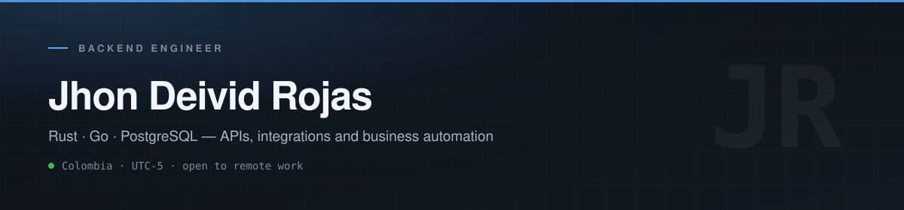

  

 

<!-- TODO: reemplaza el href y descomenta cuando tengas la URL

-->

## Focus

I build APIs and integrations that connect business systems and remove repetitive work: internal tools, messaging automation, and backends that hold up in production.

- **Backend:** Rust (Axum · SQLx) as my current stack, plus Go, Java/Spring Boot, and PHP/Laravel.
- **Integrations:** WhatsApp Cloud API, Facebook Messenger, webhooks, lead capture, routing, and human handoff.
- **Delivery:** PostgreSQL and Redis, Docker Compose, reverse proxy on Linux, and AI provider integrations (OpenRouter, DeepSeek, OpenAI) with cost control.

## Selected projects

| Project | What it does | Stack |
| --- | --- | --- |
| **[Kairos](https://github.com/JDTWOR/kairos)** | Persistent CLI agent for Linux: conversations, task state and cost tracking in SQLite, streaming over OpenRouter, task panel in the terminal. In development. | Rust · SQLx · SQLite · OpenRouter · TUI |
| **[VPS Stress Lab](https://github.com/JDTWOR/prueba-aplication)** | Full-stack lab that pushes a small VPS to its limit: configurable concurrent workloads, hard limits on the backend, and reproducible k6 runs. | Rust · Axum · PostgreSQL · Redis · React · Caddy · k6 |
| **[Academic Scheduler](https://github.com/JDTWOR/programacion-instructores)** | Scheduling engine for instructors: multi-week horizon, real teaching hours, availability, hard and soft constraints, JSON/CSV/XLSX in and out. | Python · OR-Tools · CP-SAT |
| **[CDATTG-WEB](https://github.com/senacdattg/CDATTG-WEB)** | Academic and administrative platform for CDATTG (SENA): attendance, people management and infrastructure. Built with the team; repository lives in the project organization. | Go · Gin · GORM · React · TypeScript · PostgreSQL |

Every repository above documents how to run it: required environment variables, `docker compose up`, and the limits of what the project does and does not do yet.

## Working together

- **Location and time zone:** Colombia, UTC-5.
- **Languages:** native Spanish, English B1 and actively studying. I prefer to start in writing and come to a call with an agenda.
- **How I scope work:** a small first milestone with a clear input, expected output, acceptance criteria and handover. Bigger projects are split into paid phases.

If you want to talk, write to **[jhonrojasr253@gmail.com](mailto:jhonrojasr253@gmail.com)** with the problem you want to solve, the tools you use today and your timeline. I will reply with a concrete first step.

## Stack

| Area | Technologies |
| --- | --- |
| Backend | Rust, Axum, SQLx, Go, Gin, GORM, Java, Spring Boot, PHP, Laravel, C#, .NET |
| Data | PostgreSQL, Redis, SQLite, MySQL |
| Frontend | React, TypeScript, Vite |
| Integrations | REST APIs, webhooks, WhatsApp Cloud API, Facebook Messenger, OpenRouter |
| Infrastructure | Docker, Docker Compose, Linux, Caddy, Git |
